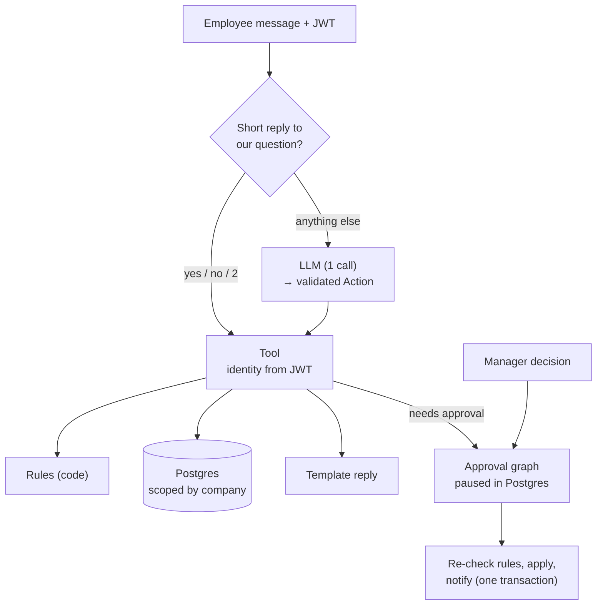

# Shift-Change Request Agent

A multi-company chat agent for office-cab shift changes. Employees ask in plain
language to see, move or cancel a pickup or drop. The agent applies their
company's rules in code, escalates to a manager when needed, and resumes after
a restart.

**Stack:** Python 3.12 · FastAPI · LangGraph · Postgres · JWT

**Demo video (2 min):** [Watch on Google Drive](https://drive.google.com/file/d/12JtSd7zmEJvzFHoFIwVF0-fHzeVGKVnE/view?usp=sharing)

## Features

- Understands vague requests ("can I go a bit late?") and follow-ups ("make it 8 instead")
- Per-company cut-off, seat and override rules, enforced in code
- Strict company isolation: identity comes only from the JWT
- Manager approval that pauses and survives a service restart
- Plain-language replies for every failure: tool timeouts, LLM outages, a cab filling up
- At most 2 LLM calls per message; p95 latency 613 ms with a real model
- Race-safe seat allocation: one seat, one request, even under concurrent submits

## Quick start

```bash
docker compose up --build
```

Open http://localhost:8000. For live chat, add a free Groq key first:
`cp .env.example .env` and set `LLM_API_KEY`. Tests and the offline eval need no key.

| Task | Command |
|---|---|
| Run tests | `docker compose run --rm api pytest` |
| Run eval (offline) | `docker compose run --rm api python -m eval.run` |
| Run eval (real LLM) | `docker compose run --rm api python -m eval.run --real` |
| Reset demo data | `docker compose run --rm api python -m app.seed` |

To write eval results back to your checkout, add `-v "$PWD/eval:/srv/eval"` after `--rm`.

### Evaluation set

The filled evaluation set, with the fields `id, input, expected, actual, pass, notes`, is:

- **[`eval/results.jsonl`](eval/results.jsonl)**: offline run (fake LLM), **43/43 pass**
- **[`eval/results_real.jsonl`](eval/results_real.jsonl)**: real LLM (`qwen/qwen3.8-27b` on Groq), **42/43 pass**

[`eval/cases.jsonl`](eval/cases.jsonl) holds the same 43 cases as input only, so `actual` and `pass` are empty.
`python -m eval.run` reads it and writes `results.jsonl` (or `results_real.jsonl` with `--real`).
Method and the one failure are explained in [EVALUATION.md](EVALUATION.md).

### Sample data

| Company | Cut-off | Seats/cab | Manager override |
|---|---|---|---|
| Acme Corp | 120 min | 4 | yes |
| Globex Ltd | 60 min | 6 | no |

Employees: `E101` `E102` `E103` (Acme), `G201` `G202` (Globex). Managers: `M100`, `M200`.
The clock is fixed at 17:00 IST (`DEMO_TIME`) so results are repeatable.

## Architecture



The LLM only interprets the message. Identity, rules, seat allocation and reply
text are all handled in code.

```
app/
  llm.py        prompt, Action schema, LLM client
  agent.py      chat graph: understand → handle → reply
  tools.py      roster, cab options, change request, cancel, status, policy
  rules.py      cut-off, cab full, trip in past (pure functions)
  repo.py       all SQL, filtered by company; atomic seat moves
  approval.py   manager approval graph (interrupt / resume)
  replies.py    every message the employee sees
  auth.py       JWT issue and verification
  main.py       API routes and error handling
eval/           evaluation set, runner and results
tests/          68 tests against real Postgres with a fake LLM
```

## Design decisions

- **One narrow LLM job.** The model turns a message into a validated `Action`
  (tool + direction, day, time, option, shift). Everything else is code.
- **Rules in code, re-checked at every step:** when options are shown, on
  confirmation and on approval. Cab full and trip-in-past can never be overridden.
- **Identity from the token only.** No tool accepts an id from the model; every
  query filters by `company_id`, backed by a composite foreign key.
- **Template replies.** A confirmation is built from the row just committed, so
  it can't claim something that didn't happen.
- **Confirm before changing.** Every change is shown first and needs a "yes".
  Plain yes/no/option replies are read by code, not the LLM.
- **Approval in its own graph thread,** checkpointed in Postgres, so it survives
  restarts and the employee can keep chatting while it waits.
- **Concurrency via conditional updates** (`WHERE seats_taken < capacity`) and a
  partial unique index, inside one transaction. No application locks.
- **Postgres only.** Transactions, checkpoints and the audit log in one service.

**Latency and call budget.** At most 2 LLM calls per message (one repair
attempt), sharing a 4 s budget, with a 2 s database statement timeout. This
bounds LLM time, not the whole request; the 5 s p95 target is met by
measurement (see [EVALUATION.md](EVALUATION.md)).

## Trade-offs

- Template replies are less conversational, but always correct.
- A single planner call instead of a ReAct loop: predictable cost and latency, no multi-step reasoning.
- The LLM resolves times like "8" → 20:00; the employee confirms the exact time.
- Notifications are delivered by polling, not websockets.
- Raw SQL instead of an ORM: about 15 short queries.

## Limitations

- Time changes and cancellations only; no route changes or new bookings.
- One timezone (IST) and one cut-off per company for pickups and drops.
- Pending requests are not expired automatically when the trip leaves.
- `/auth/token` is a mock identity provider.
- Concurrent messages from the same employee can race on chat history (seat allocation stays safe).

## Evaluation

43 scripted cases across isolation, cut-off rules, restart, tool selection,
ambiguity and failures: **43/43 offline, 42/43 with a real LLM** (the one
failure is a provider timeout). Details in [EVALUATION.md](EVALUATION.md);
raw results in [`eval/`](eval/).
